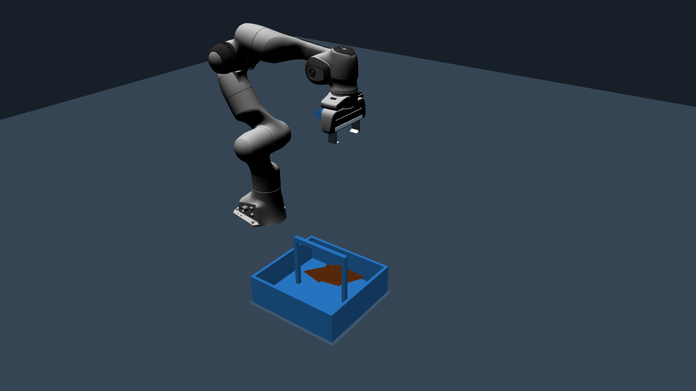
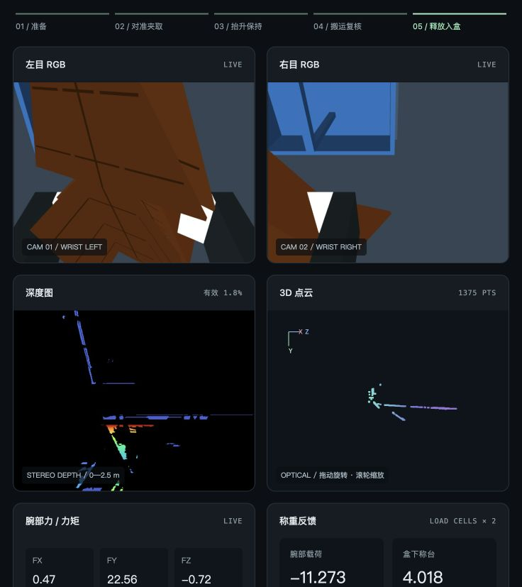
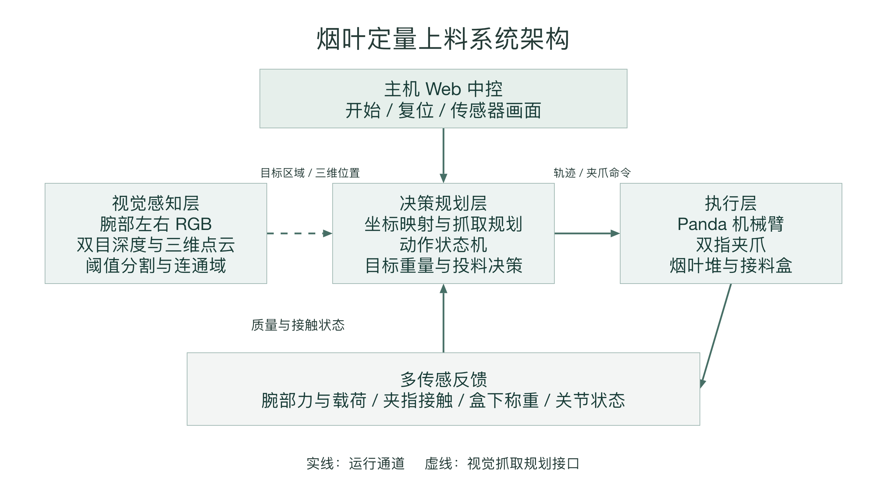

# Tobacco Leaf ROS 2 Simulation

基于 ROS 2 Jazzy、Gazebo Harmonic 和 Panda 双指夹爪的烟叶接触抓取仿真，包含腕部双目 RGB、实时深度与点云、称重反馈以及主机 Web 中控。



## 已验证功能

- 程序化烟叶外形与分片柔性模型，共用可见几何和碰撞几何。
- 固定工位单片与三片叠放的夹起、保持、搬运、释放，历史验收各 3 次通过。
- 腕部载荷与盒下净重测量。新增双目显示后复验：三片理论质量 34.292 g，入盒净重 34.281 g。
- 同时间戳双目配对、SGBM 深度、三维点云，网页支持点云旋转和缩放。
- 24 片随机姿态合成数据、HSV 阈值与连通域分析、标定参数扰动实验。

**范围：** 当前稳定演示使用固定抓取工位。任意目标批重闭环、视觉自主选择抓取点与整盒交付尚未完成联合验收。合成数据检测结果与三片机械试验分别统计，不代表任意烟叶堆的端到端成功率。

## 环境

推荐 Ubuntu 24.04 桌面、ROS 2 Jazzy、Gazebo Harmonic。原验收使用 gz-physics **7.8.0**，自定义插件按此版本编译；更换物理引擎版本需重新验收。Panda 资源通过系统包安装，不随仓库分发。

配置好 ROS 2 / Gazebo 官方软件源后：

```bash
sudo apt install build-essential cmake git python3-numpy python3-scipy \
  python3-opencv python3-matplotlib python3-tk \
  ros-jazzy-ros-gz ros-jazzy-gz-ros2-control ros-jazzy-ros2-controllers \
  ros-jazzy-moveit-resources-panda-description ros-jazzy-cv-bridge \
  libgz-physics7-dev libgz-common5-dev libgz-math7-dev libbullet-dev
source /opt/ros/jazzy/setup.bash
bash leaf_course/physics/build_contact.sh
```

构建会下载固定标签 `gz-physics7_7.8.0` 并应用接触几何补丁。不会修改系统安装的物理引擎。

## 离线视觉实验

不需要 Gazebo；建议用独立 Python 环境安装 `requirements.txt`。

```bash
cd leaf_course
python3 -m unittest test_stereo.py
python3 evaluate.py
```

结果写入 `leaf_course/evidence/`，包括检测标注、点云、搭接高度与标定误差图。

## 机械验收

在 Ubuntu 桌面会话终端运行，首次运行完整的 3 次单片和 3 次多片验收：

```bash
bash leaf_course/test_multileaf_mechanics.sh --full
```

程序先检查单片结果，再允许三片测试；每轮证据保存在独立目录。若要在相同源码与插件下复播，将上次成功的目录名填入：

```bash
LEAF_SINGLE_BASELINE=cradle-run-YYYYMMDD-HHMMSS \
  bash leaf_course/test_multileaf_mechanics.sh --replay
```

以上占位值应替换为终端实际输出的目录名。请勿与 Web 演示同时运行，二者共享 ROS domain 41 与 Gazebo partition。

## Ubuntu 仿真与主机中控

在 Ubuntu 桌面终端启动：

```bash
bash scripts/start_demo.sh
```

启动脚本生成独立的 `live_mechanics` 工作目录，打开 Gazebo，并启动三片演示后端、双目与遥测服务。点击开始执行夹取，完成后点击全部复位。窗口较慢时等模型加载完成。

在 Mac 或其他主机终端建立 SSH 隧道，将 `USER@UBUNTU_HOST` 替换为实际连接：

```bash
ssh -N -L 18082:127.0.0.1:8082 -L 18083:127.0.0.1:8083 USER@UBUNTU_HOST
```

另开主机终端，在仓库根目录运行：

```bash
python3 leaf_course/mechanics_control_host.py
```

打开 <http://127.0.0.1:8082/>。主机代理和虚拟机后端均仅监听回环地址。



## 系统架构



[可编辑 PowerPoint 源图](docs/architecture.pptx)

## 目录

| 路径 | 内容 |
|---|---|
| `leaf_course/` | 场景生成、传感器、动作与视觉实验代码 |
| `leaf_course/experiments/multileaf_motion/` | 已通过的三片动作与夹指几何配置 |
| `leaf_course/physics/` | 固定版本接触物理插件构建与补丁 |
| `leaf_course/mechanics_profiles/` | 历史机械验收结果与源码摘要 |
| `scripts/` | 可迁移的演示准备与启动入口 |
| `docs/` | 实测截图、结果与系统架构 |

Python 文件保留相邻布局，便于现有 ROS launch 与生成器解析资源。运行产物、日志、缓存、第三方编译树和个人主机配置不进入版本控制。原工程中的探索性实验代码保留供研究，稳定入口为上面列出的命令。

## 许可证

项目代码采用 [Apache-2.0](LICENSE)。Panda 衍生模型声明与外部依赖见 [NOTICE](NOTICE)。烟叶质量、柔性和摩擦参数为仿真建模参数，不是实物材料标定值。
